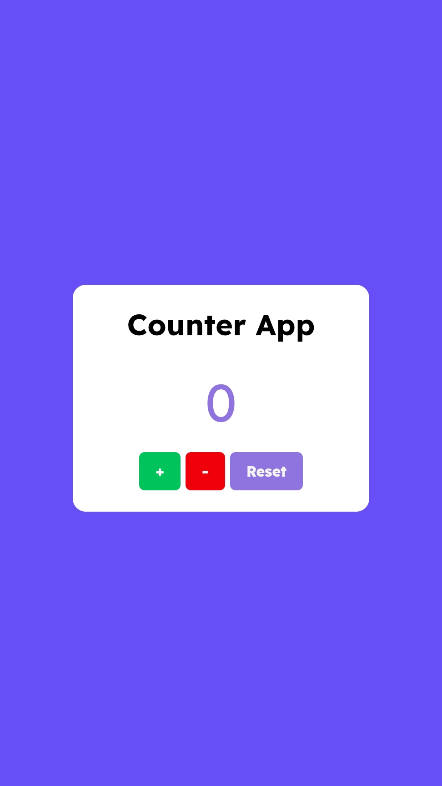

# Counter App

A clean and interactive **Counter Application** built from scratch as my first hands-on practice project while learning **JavaScript** fundamentals.

  

---

## About the Project
This project represents my first practical step in moving from static layouts (`HTML` & `CSS`) to interactive web development using **JavaScript**. Even though it is a simple application, building it helped me understand how user actions connect to dynamic changes on the screen.

## Features
- **Increment (`+`)**: Increases the counter value by 1.
- **Decrement (`-`)**: Decreases the counter value by 1 (supports negative numbers).
- **Reset (`Reset`)**: Resets the counter back to `0`.
- **Responsive & Clean UI**: Centered card layout with smooth hover transitions and custom typography (`Lexend Deca`).

## Built With
- **HTML5** – Semantic structure for the counter card and controls.
- **CSS3** – Flexbox alignment, custom colors, Google Fonts, and hover effects.
- **JavaScript (Vanilla JS)** – DOM selection (`getElementById`, `querySelector`), event listeners (`addEventListener`), and state updates.

## Challenges & What I Learned
- **Connecting JS to the DOM**: At first, I thought about creating and deleting HTML elements dynamically from JavaScript, then I learned that keeping the structure in HTML and updating the state via JavaScript is cleaner and easier to maintain.
- **Avoiding Code Repetition**: Instead of updating the display inside every button click separately, I created a single `update()` function to keep the code clean.
- **Code Refactoring**: Improved naming conventions (e.g., renaming `non` to `minus`), fixed CSS properties (`font-weight`), and added `cursor: pointer` for better UX.

---

### Author
- **Hussein Alaa (`D13hn`)** – Front-End Web Developer
